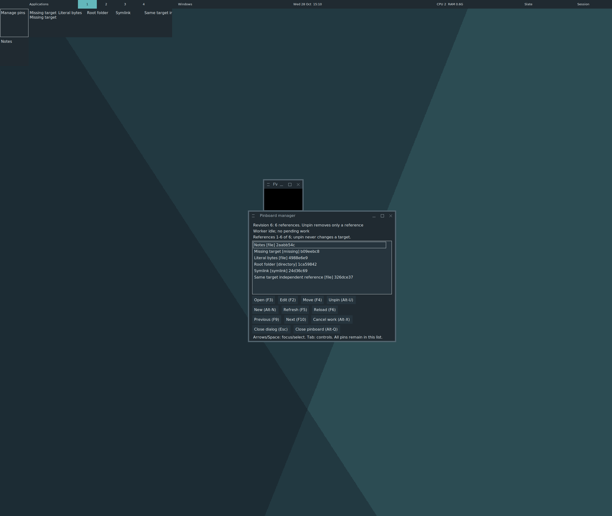
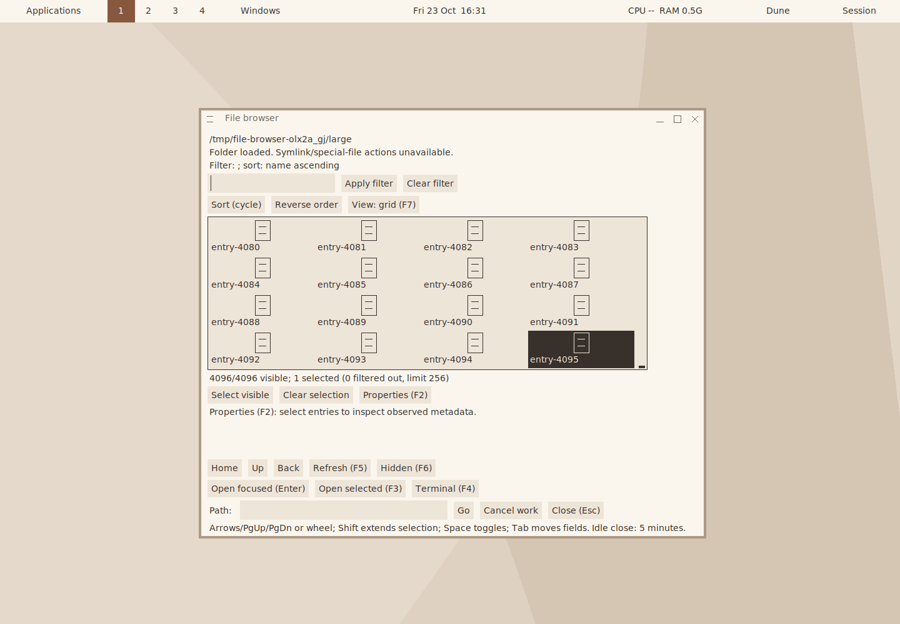

# FVWM-X

FVWM-X derives from FVWM3: X11 on Linux, FreeBSD Xorg and OpenBSD Xenocara,
AMD64/ARM64.

Preserves FVWM configurations. No compositor or Wayland.

**Status:** R1 development: configurable, fast, low-memory desktop
lite. Builds require Go. [Build/upgrade notes](INSTALL.md).

- Session controls, logout, services and scaling.
- Opt-in notifications, actions, keyboard center and bounded history;
  [scope and theme screenshots](doc/development-preview.md#native-notifications).
- Atomic buttons, layout and [component editors](doc/development-preview.md#independent-component-settings-in-progress);
  [opt-in application font/icon/cursor preferences](doc/FvwmDesktop.adoc#_application_preferences).
- Source-aware reports, ancestry, [theme-color reload](doc/development-preview.md#live-theme-color-reload-in-progress)
  and [theme definition provenance](doc/development-preview.md#theme-definition-provenance-in-progress).
- Structured IPC and eight-setting preview/recovery; optional
  [read-only reduced-motion portal bridge](doc/fvwm-settings-portal.adoc).
- [Localized application actions](dev-docs/verification/VERIFICATION-2026-10-29-XDG-INSTALLED.md),
  palette and startup activity.
- In progress: [named scratchpads and workspace overview](doc/FvwmDesktop.adoc#_named_scratchpads).
- Optional browser: list/grid, watching, Files handoff, app choosers
  and live updates; [opt-in FileManager1](doc/fvwm-file-browser.adoc#filemanager1-service).
  [SQLite/FTS5 deferred](dev-docs/decisions/DIRECTORY-BACKEND-EVALUATION-2026-11-02.md).
- Script selection metadata and bounded INCR paste;
  [preview](doc/development-preview.md#script-selection-and-paste-in-progress).
- Opt-in file Copy/Cut/Paste and XDND;
  [preview](doc/development-preview.md#file-clipboard-and-drag-work-in-progress).
- File jobs: folders, rename, copy/move, links, trash/restore, delete;
  progress, conflicts and cancellation.
- Native tray: XEmbed, opt-in StatusNotifier, bar popup and optional
  Buttons slot; [usage](doc/FvwmTray.adoc) and [current captures](doc/development-preview.md#native-tray-completion-work-in-progress).
- Optional Lucide glyphs; [theme examples](doc/development-preview.md#optional-lucide-menu-glyphs-in-progress).
- Optional pinboard: shaped cells;
  unpin preserves targets.

Slate pinboard.

Dune grid.

[Screenshots, theme/config examples and limits](doc/development-preview.md).
[Clipboard](doc/fvwm-clipboard.adoc), file-manager and release qualification remain open.
OpenBSD baseline: 8.0.
[Native rendering; prototype research deferred](dev-docs/decisions/REJECTED-PROTOTYPE-R1-CUTOFF-2026-11-07.md).

[R1 resource profiles](dev-docs/decisions/R1-REFERENCE-PROFILES-2026-10-26.md)
and [release scope](dev-docs/decisions/RELEASE-PLAN-2026-10-26.md).

- [Install and build](INSTALL.md)
- [Priorities and evidence](dev-docs/PROJECT-TRACKER.md)
- [Roadmap and review board](https://github.com/users/gonz0w/projects/6)
- [Contribute and validate locally](CONTRIBUTING.md)

Local validation; Actions disabled.
GPL and upstream attribution: see [COPYING](COPYING).
