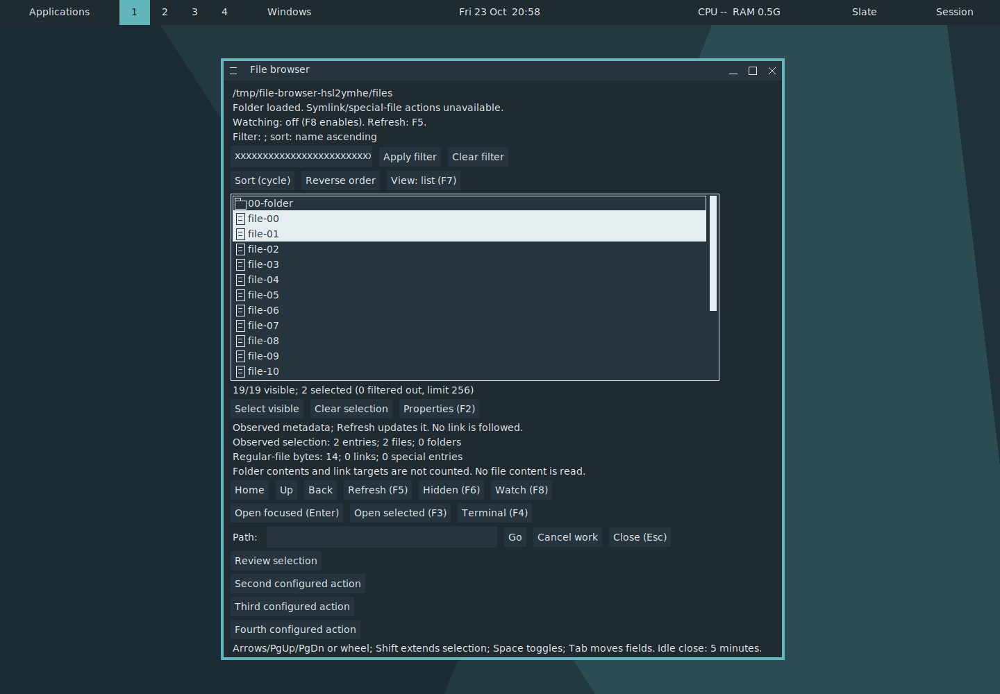
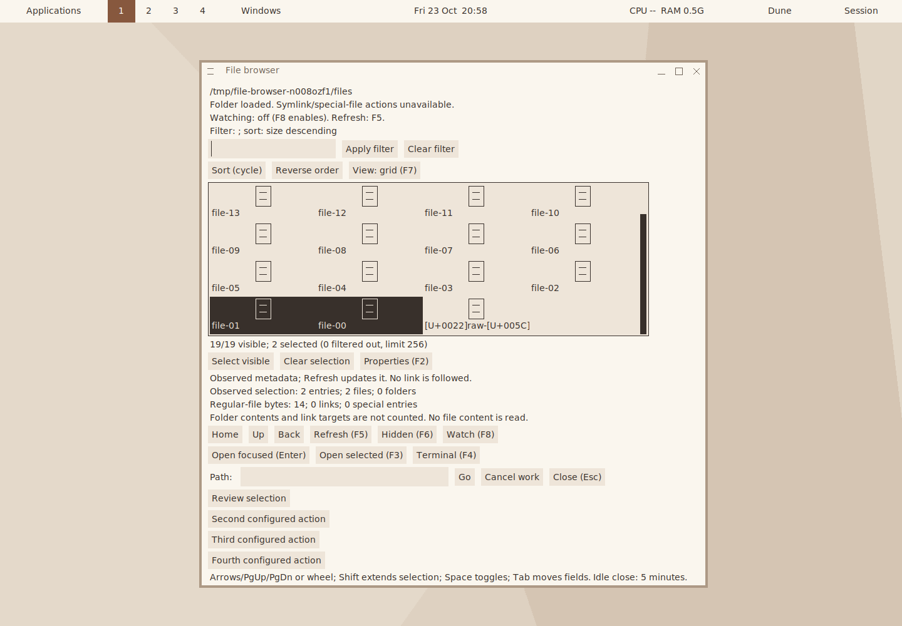
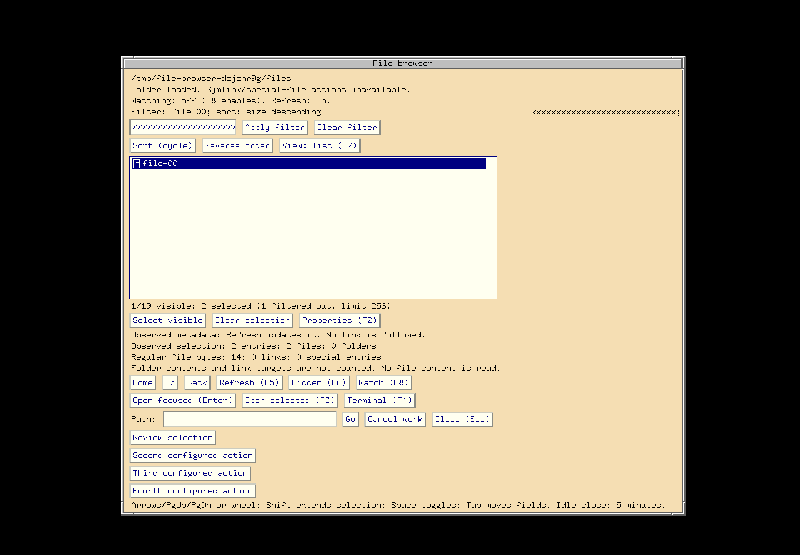

# Conditional browser controls — focused checkpoint

Five related FILE-ACTION/DATA/VIEW-01 controls are ready for review: stable-ID
selection edits, literal filtering, observed sorting, list/grid presentation and
observed properties. All require a current provider generation and acknowledge
native publication. [Contract](../decisions/FILE-PROVIDER-CONTROLS-2026-10-23.md),
[machine receipt](VERIFICATION-2026-10-23-FILE-PROVIDER-CONTROLS.json).

## Platform checkpoint first

Merged PR173–175 close the [shared platform cycle](VERIFICATION-2026-10-23-BROWSER-PROVIDER-CYCLE.md)
**before this implementation begins**: 84 selected native entries across six
targets/seven profiles (74 fresh / ten retained), 472 composed Go top-case
executions / 35 package outcomes, eight browser native-X runs including the
three themes and three retained scoped sanitizer exercises. Both OpenBSD 8.0
architectures pass; the owned guests shut down and their ephemeral keys retire.
PR175 `74c00f4e8e39607fa645bc41b0cea720486d94a1` becomes integrated reference
0/3. Reusable compiled OpenBSD Go dependencies are preserved with those archives.
Portable `make verify` passes once for that cycle, separately from native checks.

## Feature source and focused checks

The 2322-file feature source archive SHA256 is
`de952532f52c1745de47402b35819668bd0c487f4b38d8b944814a4b8973bf28`.
Product/Go/C policy inputs remain exact after freeze. A later capture-only
fixture derivation and manual/documentation changes are explicit below. Guest
hash/mode guards and host gzip/capture-file verification bind the results.

| Gate | Linux ARM64 GCC | FreeBSD ARM64 |
| --- | --- | --- |
| Affected MFL build and five registered policy/native-X entries | Pass | Pass |
| Five Go policy packages | 72 top cases | 71 top cases |
| Go race | 72 cases / five packages | Not repeated |
| Go vet and browser/command builds | Pass | Pass |
| Browser native-X | Slate dark, Dune light, classic-large | Controlled fixture |
| Accepted screenshots | 31 per theme | 31 |
| Scoped guest ASan/UBSan, leak detection enabled | Two policy entries plus MFL lifetime native-X pass | Not repeated |
| Meson helpers and three changed manuals | Pass | Not repeated |

Ten fresh registered entries cover `mfl-request`, `mfl-stream`, and actual-X
MFL requests/settings/operations on each target. Go policy plus race composes
**215 top-case executions / 15 package outcomes**. The CLI test binary uses the
same version stamp as Meson, and both built helpers match their tested binaries.
The three sanitizer exercises use the instrumented MFL/policy targets with the
unchanged standard core. These are guest checks, not a new native-Linux-CPU
sanitizer qualification. Core/Form identities retain the integrated reference.

Pure policy tests prove all-or-nothing edits, hidden selections, stale/unknown/
duplicate IDs, total limits and strict values/UTF-8/schema checks. Native MFL
checks cover directed typed actions, read-only refusal and wait-only action
cancellation retaining the producer busy slot. Real browser checks apply all
five controls, reject stale/unknown-ID requests, preserve hidden selections and
window IDs for non-layout controls, isolate malformed text and return current
acknowledged state. Existing 4096-entry/native update/watch/draft/range tests
remain covered by each browser run.

## Preserved failures and limited completions

A new unit fixture initially omits the header defining its command-size constant;
that build-only correction precedes runtime qualification. A development browser
check then exposes malformed UTF-8 being normalized by the existing JSON printer
instead of refused. MFL now validates filter text with the existing JSON UTF-8
policy before printing/forwarding; a native regression proves isolation and an
unchanged state. The final producer path uses ordinary bounded typed JSON.

A development layout check consumes an older queued publication notice after
several external controls. The observer now consumes each acknowledged
publication; only its browser driver repeats. This is an observer correction,
not evidence of a failed native layout change. All product fixes precede freeze.

Final source-bound native, Go/race, sanitizer and browser checks pass. Screenshot
inspection nevertheless catches one Dune grid image before button text paints.
The capture-only completion observes actual native button ink and stable image
pixels for the three new review captures. Only four browser runs repeat, with
all qualified binary hashes and 2322 source inputs guarded through the explicit
fixture derivation. Original screenshots/logs remain preserved. Native policy,
Go/race, sanitizer, helper and manual results are retained. No product correction
follows the freeze.

Generated-manpage inspection also catches unescaped table separators in example
values. Only the MFL manual rerenders; its corrected 18 cells and source/output
hashes verify. Working sources/builds/caches/disks remain intact; completed guest
capture duplicates are retired only after full host archive/hash verification.

## Screenshot review

These are unmodified actual-X captures at 1440x1000x24, scale 1. Exact generated
configuration/font/palette inputs and every screenshot hash are preserved. The
new review states show externally applied properties, grid layout and hidden
selection/filtering. Text, selected rows and controls are inspected in all three
configurations. Legacy long-input/label polish, wider scales and accessibility
retain separate acceptance; no claim of pixel-perfect arbitrary themes is made.

## Counters and remaining work

This feature is **1/3 on merge** after integrated PR175. The independent performance
reference remains PR174, **1/5 after PR175 / 2/5 on this merge**. The due comparison
was completed previously; no benchmark build or performance tuning repeats.

The new feature has focused Linux/early FreeBSD qualification; its accumulated
six-target/optional/compiler/install/default-X/owner/milestone/release gates remain
separate. Native-CPU, physical hardware/toolkits/compositors/assistive acceptance
also stays open. External file actions/FileManager1, mutation, protected clipboard
content and persistence retain their owners. SQLite is not needed for these
metadata/view controls. All owned QEMU jobs shut down; the shared Linux container
remains available. GitHub Actions and status publishers remain disabled.
