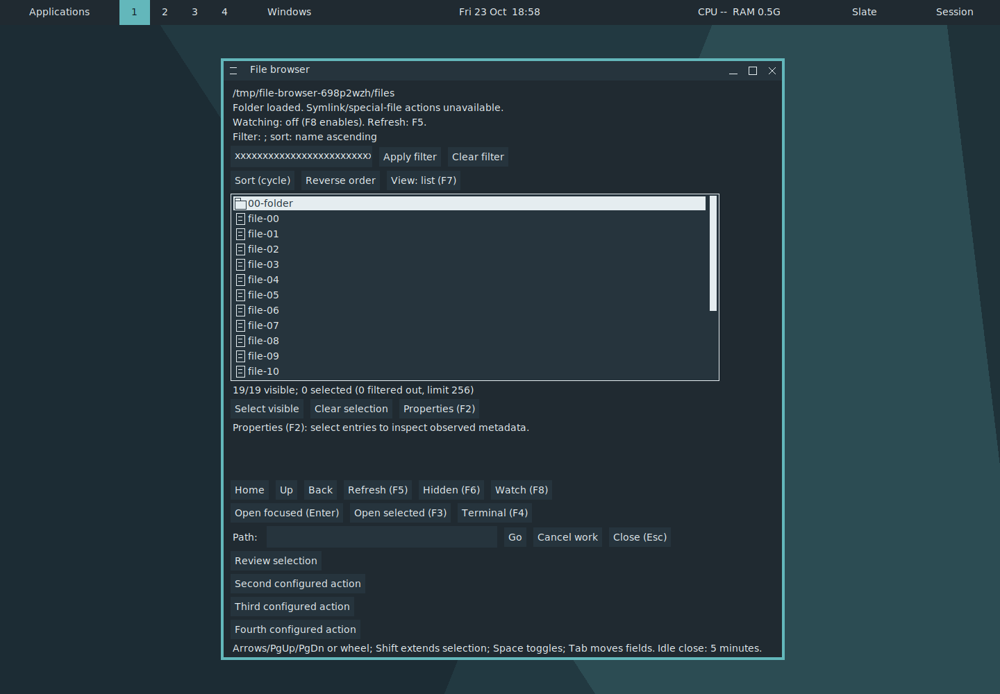
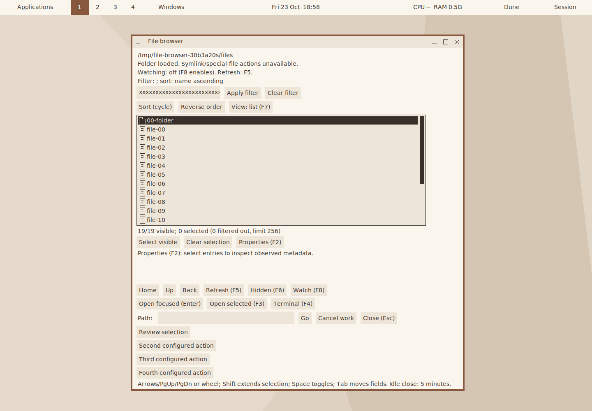
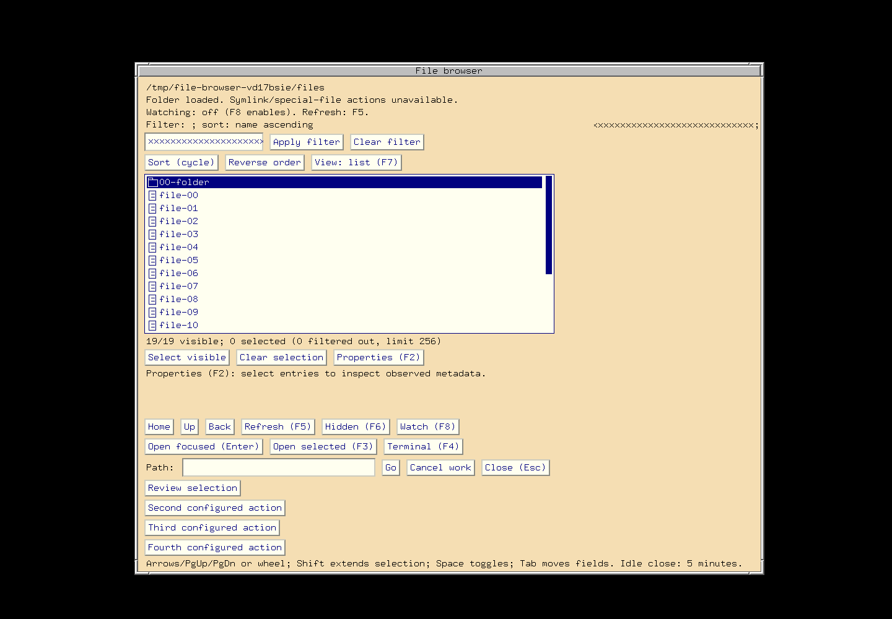

# Read-only file-provider queries — focused checkpoint

Four related FILE-DATA/VIEW-01 capabilities are ready in
[PR #175](https://github.com/gonz0w/fvwm-x/pull/175): bounded browser
instance discovery, generation-bound metadata/current-selection pages, typed
observed selection summaries and a correlated `FvwmCommand --request` mode.
[Contract](../decisions/FILE-PROVIDER-QUERIES-2026-10-23.md),
[machine receipt](VERIFICATION-2026-10-23-FILE-PROVIDER-QUERIES.json).

Source is based on merged PR174 `665bfcdc557b1c25dae216e96b3346ce30fd1814`.
The 2310-file archive SHA256 is
`499a5a4cf34812bf4334fefd9a08da026037c48ae5e8ffc63b1387f6e02c0e77`.
Product/test/build inputs retain the freeze, with two explicit C line-wrapping
derivations described below. README, architecture, tracker, index, report and
screenshot amendments are documentation. Guest input guards and the final Linux
post-format guard bind all 2310 frozen file hashes/modes to these derivations;
all four gzip archives and every captured file/size/hash validate on the host.
The original failures remain part of this composed result.

## Focused checks

| Gate | Linux ARM64 GCC | FreeBSD ARM64 |
| --- | --- | --- |
| Affected MFL build and registered C/native-X checks | 5 passes | 5 passes |
| Go collection/filemodel/browser/command/transport policy | 68 top cases / 5 packages | 67 / 5 |
| Go race | 68 / 5, composed after disk recovery | Separate native-CPU race acceptance remains open |
| Go vet and browser/command builds | Pass | Pass |
| Real browser/native Form | Slate dark, Dune light, classic-large | Controlled fixture |
| Screenshots | 28 per theme | 28 |
| Scoped ASan/UBSan, leak detection enabled | 2 policy entries + real-X client lifetime driver pass | Not repeated |
| Meson helpers and three changed man pages | Build/render pass | Not repeated |

The registered entries are `mfl-request`, `mfl-stream`, `mfl-request-xvfb`,
`mfl-settings-xvfb` and `mfl-operations-xvfb`: ten fresh selected results across
two targets. Scoped sanitizer policy repeats the first two and exercises the
actual-X request driver using the sanitized MFL with the unchanged standard
core. Go policy plus composed race totals **203 top-case executions and 15
package outcomes**. These are guest executions on the local macOS host, not a
new native-Linux-CPU qualification. Core and Form fingerprints retain PR174.

Actual-X checks prove read-only discovery, eight-provider admission, duplicate
identity/capacity refusal, dedicated owner routing, wrong-owner/stale-serial
isolation, ordered chunk assembly, pending inspection, wait-only cancel/timeout,
retained producer busy state, waiter/owner disconnect and replacement, and
malformed-producer isolation. Browser runs discover the real instance through
an independent client, query paged raw-byte metadata, use the CLI, observe a
selection made without a button callback, refuse an obsolete continuation and
return typed properties without changing native window IDs. Existing filtering,
4096-entry live/grid/range behavior, drafts, watching and manual recovery remain
covered. Pure Go tests cover exact 64-bit integers, malformed requests, result
bounds, hidden selections and CLI correlation/disconnect/error framing.

## Failures and limited recovery

The development real-X driver exposes a missing pending-allocator admission for
FILES_QUERY. The allocator and its unit regression are corrected before freeze;
focused development C/native-X/Go/browser checks then pass.

The initial combined Linux gate passes all five native entries, all five policy
packages and three race packages, then two race-test links fail for lack of disk
space. No race failure is inferred from a linker error. Two completed compressed
source duplicates (18,884,255 bytes) and 213 individually hash-matched files from
a completed style capture (59,453,133 bytes) are retired against preserved host
archives. Unmatched evidence, working source/builds, SDK/cache and disks remain.
Only the two unfinished race packages and not-yet-run gates execute afterward;
passing source-bound results are retained.

The last verification assertion compares a version-stamped Meson FvwmCommand
against an unversioned development build. All three theme drivers and scoped
sanitizers had passed. A focused completion rebuilds with Meson's exact version
flag and proves byte equality, runs the Meson command-client regression and
preserves all three generated manuals. No behavior change or theme/race/sanitizer repeat follows this correction. A local CLI socket test initially
needs execution outside the filesystem sandbox; its permitted rerun passes.
README length is corrected to the repository's 250-word limit; hygiene passes.

A final C style review wraps long lines in FvwmMFL and its request unit fixture.
All lexical C tokens are equal after ignoring comments/whitespace and joining
adjacent string literals; before/after hashes and the equivalence proof are
recorded. The affected Linux MFL/unit targets rebuild and two request entries
(policy and actual-X) pass again. These are two extra focused checks, not a new
matrix. Existing theme, race, BSD and sanitizer evidence retains its exact
original source plus this formatting-only derivation. A final Linux guard checks
all 2310 source files and records the final binary identities.

## Screenshot review

These unmodified actual-X captures show current native selection queried before
an action callback. The selected row is current; fixed count/property labels
still show their last published callback state. Queries preserve those labels,
input drafts and native windows. No new widget or rendering style is introduced.
Theme configurations, fonts, 1440x1000x24 display and scale 1 are preserved with
the captures. Slate/Dune text and selected-row contrast remain readable; the
classic larger-font view retains its legacy colors and layout. Wider scale,
long-label polish, accessibility and default-X acceptance remain separate.

## Performance and remaining gates

The due [PR169→PR174 comparison](PERFORMANCE-2026-10-23-PR174.md) uses preserved
qualified binaries, not a rebuild: 4096-file scan medians 16.046/15.998 ms,
overlapping trial ranges and unchanged 29,288 KiB median maximum RSS. Browser
file size grows 3.02%, Form 1.56% across those features; core/old MFL bytes are
unchanged. This does not measure the newly changed MFL or establish a speedup.
PR174 becomes performance reference 0/5, 1/5 on this merge.

The PR172 integrated reference is at 2/3 after merged PR173–174, 3/3 on this
provider-query merge. Close accumulated affected six-target integration before
a fourth implementation PR. This batch has early native FreeBSD coverage;
new OpenBSD 8.0/AMD64 checks are not claimed. Full compiler/optional profiles,
install/default-X/owner/milestone/release, hardware/toolkit/compositor/assistive,
file mutation, FileManager1/typed external actions and protected clipboard-content
acceptance remain open. SQLite remains deferred. FreeBSD is shut down; the shared
Linux environment remains available. No Actions or status publishers are added.
