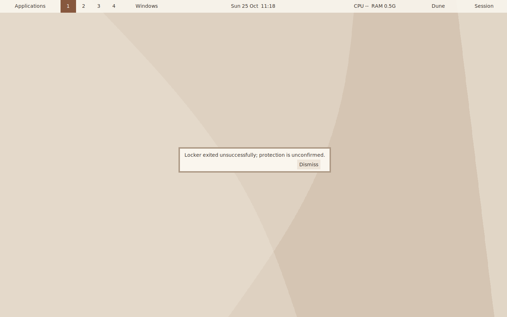
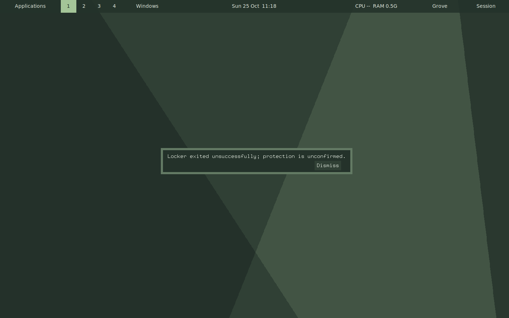

# M2.10: native ARM64 execution acceptance

The receipt-matched installed ARM64 controller family completes the fixed plain
and resident-GC workloads and full safe session-action smoke on Linux ARM64 in
the verified AppleHV VM. Environment, ELF and live process evidence support
native AArch64 instruction execution for these exercised paths. Full-session
owner acceptance remains pending before M3; no production or test logic changes.

PR202 merged as `cead217dbba5bb5f0d9862439b3f837e88553b8d`, with canonical
signature, author DCO and exact PR tree verified; its completed branch is retired.
All 1,185 runtime/build inputs and 124 uploaded test sources match the merged
tree. All 100 staged files and native build identities remain exact before/after.
There is no rebuild, benchmark comparison or OS matrix. PR202's 74 pure session
cases and prior platform qualification retain their source-bound scope; they
are not rerun or relabeled as fresh passes. Docs use `make check lint` and diff
review; the three installed X runs are the new acceptance evidence.

## Execution environment and proof

- Host/provider: macOS ARM64, Podman 6.1.0, active `podman-machine-default`
  using `applehv`; the existing designated container remains running.
- Guest: Fedora43 kernel `6.18.10-200.fc43.aarch64`, Ubuntu 24.04.5 userspace.
  VM and container kernel boot IDs match. `/proc/cpuinfo` identifies Apple CPU
  implementer `0x61`. This does not qualify a native Ubuntu kernel baseline.
- The 25 staged ELF executables are ELF64 little-endian AArch64 (machine 183).
  Each run also captures the actual core and controller's `/proc/<pid>/exe`
  hashes, ELF machine, start identity, ancestry and maps. There are 11, 12 and
  37 sampled process/executable identity records, all AArch64, with no reported
  probe errors. Actual core/controller hashes match the preserved stage.
- The loader path appears in sampled core maps; its separately recorded
  post-run identity is also AArch64. Visible `binfmt_misc` entries are empty;
  that is namespace visibility, not a claim about all host registrations.
  The claim relies on the bound provider/kernel and actual ELF/process execution,
  rather than accelerator availability or metadata alone.

This is a new hardware-virtualized native ARM64 subset. Historical reports that
did not qualify native CPU execution retain their original flags. It is not
bare metal, native AMD64, full native Linux/Ubuntu qualification, native sanitizer
execution, native comparative performance or physical hardware acceptance.

## Focused installed results

| Existing check | Result | Actual scope |
| --- | --- | --- |
| Plain fixed workload | Passed, 17.429 s | Eight correlated discoveries of 512 records; sixteen actual search/files grabs and dismissals; existing settings/query and synthetic input activity. |
| Separate resident-GC workload | Passed, 16.957 s | Same fixed activity; nine natural resident cycles, complete trace parsing, no forced collection or tuning. |
| Full safe session-action smoke | Passed, 3.272 s | Installed Command/directory/full-menu/browser/offline checker, native screenshot, safe power/locker failures, duplicate refusal, held locker across controller restart/core logout and final release/reap. |

All three cores exit successfully with no unexpected observer X errors or
cleanup errors. Each exact journaled core/observer/X-server process identity is
retired. Both workload observers stop without a sampler error or limit. No load
escalation, deadline change or retry follows the results.

The resident GC run's largest first+final clock-phase sum is 0.123 ms, observed
only in this instrumented run. Worker stderr, worst-case pauses and causal
relationships to input are outside scope. Plain admission key/Echo samples have
median 0.407 ms and range 0.278–0.551 ms; traced samples remain separately recorded.
These synthetic events exclude physical input and completed painting. The
pre-input `running` snapshots do not prove execution overlap at input arrival.
The extra read-only process probe is part of the recorded environment. Do not
compare these values to emulated AMD64 timings or infer general speed/power.

Proc observations retain partial samples and intervals: the activity phases have
91/90 plain and 84/83 traced partial samples/intervals. Missing data is not zero.
No writable delegated cgroup parent or tracefs instances are exposed here, so
neither kernel option is requested; charged peaks, scheduler wakeups and related
complete-accounting claims stay unavailable. PR201's emulated AMD64 kernel
measurements remain separate evidence, not native ARM64 measurements.

The full smoke runs in the existing installed environment with the real character
null device (1:3). It does not construct a fresh Python-free root on this nearly
full filesystem. PR201's separate Python-free namespace proof keeps its original
scope. Shell backend peers and the external Python observer remain explicit;
"Python-free" does not mean every interpreter is absent. Safe peers deliberately
avoid real authentication and power actions and establish no locker readiness,
physical login or actual power-operation claim.

Eight screenshots are captured and inspected: existing search/files menus, a
native session capture and three requested notice/font/palette views have
readable controls. This is a notice/menu smoke, not full theme, accessibility or
physical display qualification. Two unmodified examples show the expected safe
locker-failure notice; the failure message is intentional fixture behavior.

## Integrity, cleanup and next acceptance

[Machine receipts](VERIFICATION-2026-10-25-M2-NATIVE-ACCEPTANCE.json) bind the
source/test archive, commands, provider, actual ELF identities, outcomes and
limits. Canonical raw evidence lives under
`builddir/codex-2026-10-25/m2-native-acceptance/`. Its full gzip CRC and every
captured payload's hash/size/mode verify; all 57 stored payloads are preserved
on the host. The small test-only upload avoids another complete source copy.

Before execution, seven completed source-upload archive duplicates are matched
to six canonical host archives. Full host CRC and 12,215 payload hashes/modes
verify before exact guest hash/size checks and retirement of 53,412,419 bytes.
After execution, 59 new completed capture/archive duplicates retire
(5,204,333 bytes), with all exact owned process identities gone. Source, builds,
caches, installed stages, disks and other owners remain preserved. The shared
machine/container is not stopped. No dependency, privilege, mount, tracing-policy
or machine configuration changes are made.

Separate analysis/source/evidence review checks the finite native subset and
resolves its findings. Requested routed model settings remain unverified because
observed model/client metadata is unavailable. Agent review is not independent
human approval or full-session owner acceptance.

Next is Cam's review and explicit acceptance of the accumulated M2 evidence and
documented remaining limits before M3. No unported controller or additional
observer implementation is selected. Native AMD64/Ubuntu/sanitizer, actual
authentication/power/login, physical input/paint and release/hardware/toolkit/
compositor/assistive requirements retain their separate owners. GitHub #23's
manual closure is preserved; #7/#15 remain open. This checkpoint does not waive
those gates or authorize M3, features, tuning, M6/M7 or release publishing.
