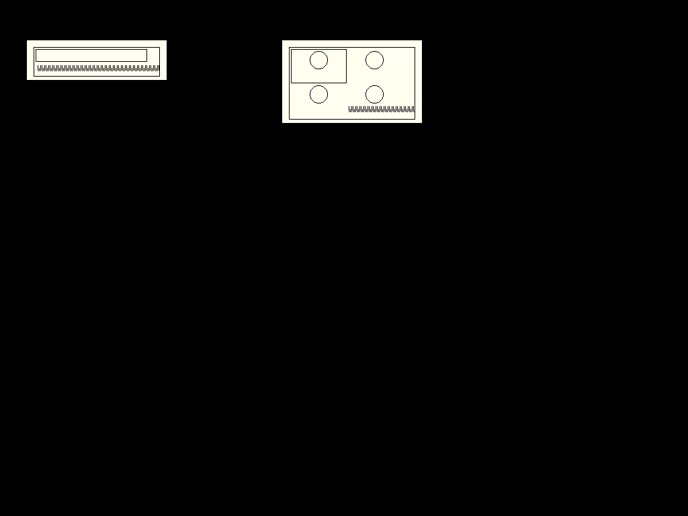
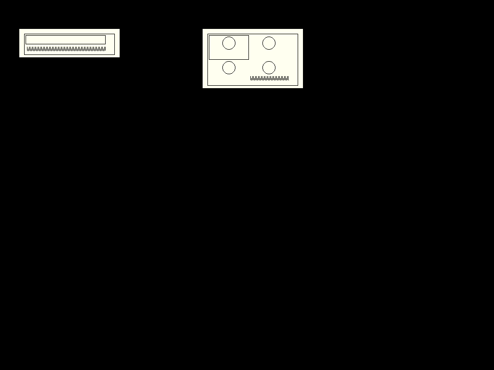

# Native layout paint-boundary closeout

G16 closes the revised R1 outcomes for #211 and #212. Cam explicitly approved
moving the remaining rejected Cairo/Clay prototype research to
[R2 #366](https://github.com/gonz0w/fvwm-x/issues/366). The
[accepted cutoff](../decisions/REJECTED-PROTOTYPE-R1-CUTOFF-2026-11-07.md)
changes only those prototype-research prerequisites. Production defects,
configuration compatibility, safety, platform support and release checks remain
R1 requirements with their existing owners. Unavailable results stay unavailable.

Base: merged PR365 `477fea09c07258d7709ef0c843eaab40aceadf40`, reviewed tree
`87f4128a7610c8324210d9e5d20bd7e18c1429e1`; canonical signature and Cam
DCO verified. The product source changes only Form collection painting.

## Product repairs

Long core/fontset captions previously assigned a string clip region but called
the raw renderer with an unclipped GC. The existing paired clipped-string helper
now applies the same cell boundary to core/fontset and Xft paths. Both icon
branches use that boundary and admit only positive extents bounded by the cell's
interior width and height. A cell too small for a mark retains its label, focus
and hit geometry. The borrowed region pointer is cleared before destruction.

The documented generic mark for an untyped grid cell remains intentional;
compact untyped lists still omit it. Provider identities, configured geometry,
selection, focus and command syntax retain their existing owners. No new
renderer, dependency, persistent state or general layout API was introduced.

## Focused native results

The retained Linux ARM64 GCC profile reproduced two real baseline defects:

| Case | Before | After |
| --- | ---: | ---: |
| Core-font compact caption pixels in gutter | 66 | 0 |
| Core-font grid caption pixels in gutter | 66 | 0 |
| 3-pixel compact cell changed pixels after adding a mark | 30 | 0 |
| 3-pixel grid cell changed pixels after adding a mark | 4 | 0 |

Candidate Slate and Dune Xft palettes also have zero out-of-cell caption pixels.
All six normal list/grid cases verify visible caption ink, blank restoration,
normal icon painting and actual keyboard/pointer selection. Classic additionally
checks the admitted tiny cells. No unexpected observer X errors remain.

The focused fixture uses four or sixteen entries and skips the existing
4,096-entry browser suite. Classic requests `fixed` to cover the core-font path;
it is not a new enlarged-font or fontset execution claim. Existing enlarged and
real mixed-monitor evidence is reused below. All four candidate screenshots were
inspected; three normal examples and the baseline are published unchanged:

| Baseline core | Repaired core |
| --- | --- |
|  |  |

[Slate Xft capture](../../doc/screenshots/form-collection-clip-slate.png) and
[Dune Xft capture](../../doc/screenshots/form-collection-clip-dune.png) retain the
same paint boundary. These are focused native test Forms, not whole-desktop
appearance or accessibility certification.

Only `modules/FvwmForm/FvwmForm` rebuilt. Its file grew from 1,923,120 to
1,923,752 bytes (+632 including debug data); this is not an RSS or timing claim.
Its resolved library closure is unchanged. The other seven G6 comparison
executables and all recorded system/private libraries retain their identities.
Full retained source verification covers 2,505 files, allowing only the current
Form C file and focused driver overlay. No install, Go/race, browser, scale,
BSD, full platform or whole-WM benchmark campaign was repeated.
The affected manual renders with the existing native Asciidoctor, with empty
renderer diagnostics. Host mandoc lint returns 3 for generated GNU preamble
`mso`/`LINKSTYLE`, existing paragraph warnings and long-line style diagnostics;
these formatter limitations are recorded, not described as a lint pass. The
new prose emits no new roff requests. Broader manual parity remains with DOCS-01.

## Failures and bounded closeout

The initial fixture quoted Form color values. Its raw-color parser preserved
the quote bytes, causing both colors to resolve to pixel zero and preventing
the caption observation. The reviewed correction removes only those four color
quotes, retaining font quoting, pixel expectations and deadlines. It adds geometry
and native-state diagnostics. That run reproduced both defects, then compilation
caught a missing declaration for the added diagnostic.

The baseline campaign stopped at its attempt limit. The lead recorded G16-C1,
a diagnosed include-only compilation closeout under existing execution authority.
Adding `libs/log.h` is its sole product-code correction. This separately reviewed
single run reuses the passed baseline and performs one affected build, three
candidate profiles and one affected manual render. It passed with four retired
command groups. It did not repeat the baseline or change its expectations.
The native closeout commands took 2.186 seconds, separately from VM startup and
source admission. Both earlier failures remain preserved honestly.

All owned sessions confirm container and machine shutdown. The initial 12-file,
repaired-baseline 19-file and successful 34-file exports and their archives match
their hashes. The first two sessions retired two and three command groups.
The latest reusable build remains in the existing profile; the host continuation
manifest records the two source overlays and new ordinary Form identity.

Artifacts: `builddir/codex-2026-11-07/r1-native-layout-closeout`.
Initial plan SHA-256:
`ec4ba8dd16b57db9fb0061b2d4a6fd72a2c71e296f0d31e9794a7c138ada9673`.
Baseline correction plan SHA-256:
`3a763352fd40ae805e51a8d45c2e64257f1c5e9a6f4f3ea63e674f8b7afebc60`.
G16-C1 plan SHA-256:
`327871ecdb650962758a45421ae84439a4024628c47d463f40f07dd3fabb1173`.
Successful receipt SHA-256:
`7b4bf6f2d869d69c7305659699e178004865e6afd1857db7169375c1df154ad0`.
Candidate source SHA-256:
`6a3491df032f922a906629a191697f5adf8b04902370764a50f3c8df6e41cf15`.
Candidate binary SHA-256:
`8f81a5fe720745b4e4c6f36f3cdc3dcf8b469674f364a1c5d1d7fa8cac66a905`.

## R1 acceptance mapping

| Owner | Result and reused evidence |
| --- | --- |
| #211 prototype/behavior | G2/G5 bounded prototype and lifetime/fallback/idle/reduced-motion checks remain accepted. |
| #211 decision/results | G6 rejects production Cairo; G5/BSD pairs and G6–G15 costs publish measured and unavailable values. The explicitly named research remainder is R2 #366. |
| #211 real-X/themes | G5's existing three-theme, interruption/resize/unmap/destroy/input evidence is retained; no fresh prototype qualification is required by the accepted cutoff. |
| #212 policies/consumers | [PR267 native layout](VERIFICATION-2026-10-26-NATIVE-LAYOUT.md) supplies prepared row/grid geometry, panel/browser consumers, resize/provider continuity and bounded observations. |
| #212 text/scale/state | [PR276 viewport scaling](VERIFICATION-2026-10-27-VIEWPORT-SCALE.md) supplies actual factors 1/1.25/1.5/2 and retained state; G16 repairs the remaining collection paint boundaries using existing text backends. |
| #212 Clay decision | G6 rejects production Clay; existing comparisons and the explicit R2 #366 transfer satisfy the revised evaluation outcome. |
| #212 feature qualification | Existing PR267/276 theme, enlarged-text, mixed-monitor and state evidence plus the current affected Linux paint regression cover the bounded native slice. Production platform/install/accessibility/release qualification stays R1 with #54/#75/#79 and their existing owners. No whole-release pass is claimed. |

The amended R1 component criteria are ready for issue closure on integration.
The whole-WM ledger advances from 4/5 to due (5/5) on this implementation merge;
the observation joins the next major-feature/shared checkpoint, as WORKFLOW
requires, rather than starting another guest solely for the counter.
